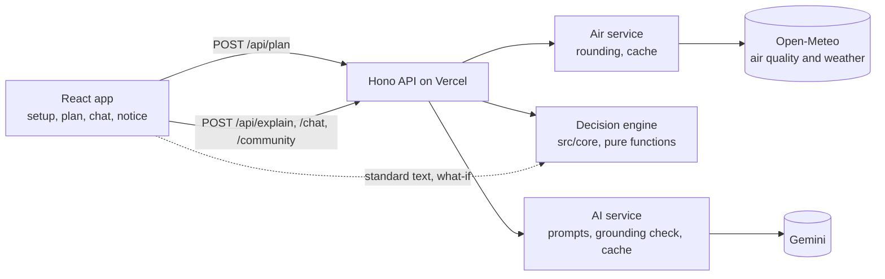

# SmogSense

[](https://github.com/kartikjoshi7/SmogSense/actions/workflows/ci.yml)

A GenAI assistant that helps families and communities get through winter smog. It reads the
live air-quality forecast for where you live, builds a plan for your household's day (low-emission
routines, indoor air hacks, sustainable alternatives) and shows the impact of every choice in
numbers. Gemini explains the plan in English or Hindi, answers questions and writes community
notices in ten languages, and it may only use the numbers the engine computed.

**Live:** https://smog-sense-sigma.vercel.app · [Architecture](docs/ARCHITECTURE.md)

**Evidence for each judging area**

| Area                         | In short                                                                                                                | Details                                |
| ---------------------------- | ----------------------------------------------------------------------------------------------------------------------- | -------------------------------------- |
| Code quality                 | Strict TypeScript, strict ESLint with layer rules, Prettier and knip as gates; no `any`, no type assertions             | [Code quality](docs/CODE_QUALITY.md)   |
| Security                     | Server-only key, Zod on every input, rate limits, strict CSP; every AI number checked; no names or conditions to the AI | [Security](docs/SECURITY.md)           |
| Efficiency                   | The plan never waits for the AI; cached, shared upstream calls; small prompts; lazy dialogs; no chart library           | [Efficiency](docs/EFFICIENCY.md)       |
| Testing                      | Unit, integration and Playwright end-to-end tests with axe; 100% coverage of the engine                                 | [Testing](docs/TESTING.md)             |
| Accessibility                | WCAG 2.2 AA checked by axe in light and dark, keyboard-only flow, 44 px targets, English and Hindi, read-aloud          | [Accessibility](docs/ACCESSIBILITY.md) |
| Problem statement alignment  | Each requirement of the brief traced to code and tests; real Open-Meteo data; works without the AI                      | [Alignment](docs/ALIGNMENT.md)         |
| Design decisions (all areas) | Ten records: why each choice was made, what was turned down, what it costs, and the tests that hold it                  | [Decisions](docs/DECISIONS.md)         |

## Chosen vertical

**Urban Air Quality Assistant.** The brief: _"Create a GenAI-powered assistant that helps families
and communities navigate severe winter smog and urban air pollution. The application should
suggest low-emission daily routines, indoor air quality hacks, and sustainable alternatives
tailored to their location and lifestyle, while clearly explaining the direct impact of their
choices."_

SmogSense is built for households in North Indian cities, where winter inversions trap smoke for
weeks, and it works anywhere Open-Meteo has a forecast (US AQI outside India).

## Approach and logic

**The engine decides and calculates; Gemini explains and talks.** A pure TypeScript decision
engine (`src/core`, no I/O, 100% test coverage) turns the forecast and the household profile into
a ranked plan with numbers. Gemini only rewrites that plan in plain language, so the numbers can be
trusted and the app keeps working when the AI is unavailable.

How `buildPlan(profile, air)` in `src/core/plan.ts` decides:

1. **Index** (`aqi.ts`): the trailing 24-hour PM2.5 and PM10 means become India's NAQI for Indian
   locations or the US AQI elsewhere, with official breakpoints.
2. **Who is most at risk** (`risk.ts`): infants, seniors and anyone with asthma, COPD, heart
   disease or a pregnancy are "high" sensitivity, children "elevated". The household is as
   sensitive as its most sensitive member, and sensitive members are told to act one band sooner.
3. **How strongly to react** (`severity.ts`): normal, caution, restrict or smog emergency. A highly
   sensitive household enters emergency mode one band early.
4. **Winter inversion** (`inversion.ts`): a low boundary layer means pollution is trapped; the
   engine says when daytime mixing should clear it, falls back to wind speed and says so, and
   says it cannot tell when there is no weather data.
5. **Candidates** (`recommendations/*`): 26 possible actions in five groups. Each is kept only if it
   fits the household (no carpool advice for someone who takes the metro) and carries its own
   numbers: exposure cut (`exposure.ts`, `windows.ts`), indoor PM2.5 before and after (`indoor.ts`,
   a mass-balance room model) and CO₂ saved per week (`emissions.ts`).
6. **Ranking** (`recommendations/rank.ts`): health benefit × how bad the air is × household
   sensitivity, plus CO₂ avoided, minus effort. In an emergency, protective actions come first.

Every requirement in the brief is traced to the code and tests that cover it in
[Problem statement alignment](docs/ALIGNMENT.md#requirement-traceability).

## How the solution works



1. **Set up (no sign-up).** Choose a place by GPS or city search, add family members (their names
   stay on the device) and describe the commute, exercise and home. The Delhi example family fills
   the form in one click.
2. **Today.** `POST /api/plan` gets the place's air-quality and weather forecast from Open-Meteo
   and runs the engine; no AI is involved, so the plan appears at once with standard guidance.
   `POST /api/explain` then swaps in Gemini's wording item by item. The request flow, caches and
   error handling are in [Architecture](docs/ARCHITECTURE.md).
3. **The plan.** An AQI card (number, category in words, icon and colour, and every pollutant
   measured this hour), the hourly PM2.5 chart
   with a table view, the inversion card, the day's timeline, five tabs named after the brief and a
   "what if" slider that recomputes exercise exposure in the browser with the same engine.
4. **Ask and share.** A chat dialog for questions such as "Can the children play outside at 4 pm?"
   and a community notice that can be copied or shared, each in any of ten languages. Both are
   loaded only when opened.

**GenAI usage.** Gemini (through `@google/genai`) is used in three places, all in
`src/server/ai/`:

| Use              | Route                 | What the model gets and returns                                                                                                                                                                 |
| ---------------- | --------------------- | ----------------------------------------------------------------------------------------------------------------------------------------------------------------------------------------------- |
| Plan narrator    | `POST /api/explain`   | The top 8 recommendations with their numbers, the household's member ids and age groups (never names or health conditions), the language → JSON headline, summary, and `why` + `steps` per item |
| Ask SmogSense    | `POST /api/chat`      | The same facts, the answer language, up to 6 earlier turns and the question inside `<user_question>` delimiters → JSON answer                                                                   |
| Community notice | `POST /api/community` | The day's facts as they apply to everyone nearby (nothing about the household), the audience and language → JSON notice                                                                         |

Every reply must match a JSON schema and pass the numeric grounding check
([Security › AI safety](docs/SECURITY.md#ai-safety)). Anything that fails, times out or cannot be
reached is replaced by standard guidance from `src/core/explain`, and each piece of text carries
an `ai` or `fallback` label that the UI shows next to it.

**Free-tier strategy.** The app runs on a free AI Studio key: small prompts, capped tokens,
caching, a cool-down after a 429 and a daily budget ([Efficiency](docs/EFFICIENCY.md#gemini-on-the-free-tier)).

**Run it locally** (Node 22+):

```bash
npm ci
cp .env.example .env.local   # add GEMINI_API_KEY; without it the app uses standard guidance
npm run dev                  # UI and API on http://localhost:5173
```

The quality gates are listed in [Code quality](docs/CODE_QUALITY.md#gates-that-fail-the-build)
and the test suites in [Testing](docs/TESTING.md).

## Assumptions

- **Data.** Open-Meteo's CAMS air-quality forecast and weather forecast are good enough for
  household planning. They are model estimates for a grid cell, not readings from a nearby monitor.
- **Index.** The headline index uses the trailing 24-hour mean, as CPCB and the EPA do, so it barely
  moves within a day; clean windows are found from hourly PM2.5 instead.
- **Privacy.** Locations are rounded before any upstream call or cache, and health conditions
  never reach the AI ([Security › Privacy](docs/SECURITY.md#privacy)).
- **Not modelled yet.** Home heating (coal or wood braziers, kerosene and gas heaters) is not asked
  about or advised on, and commute doses use the 24-hour mean rather than the hours of travel.
- **Not medical advice.** Every figure is a planning estimate. The model is instructed not to
  diagnose and to send anyone with symptoms to a doctor, and the footer says the same.
- **Languages.** The interface and the plan's explanations are in English and Hindi. Chat answers
  and community notices can be in ten languages; their standard guidance exists in English and
  Hindi, and the other languages fall back to English.
- **Coefficients.** Every coefficient and threshold the engine uses is a named constant in
  `src/core/constants.ts`, with its source; [Architecture › Assumptions behind the
  numbers](docs/ARCHITECTURE.md#assumptions-behind-the-numbers) lists each one.

Air-quality and weather data: [Open-Meteo.com](https://open-meteo.com) (CC BY 4.0). Licence: MIT.
