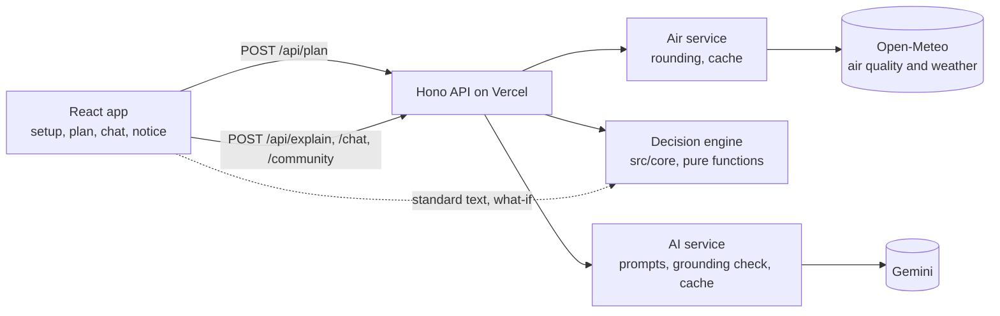
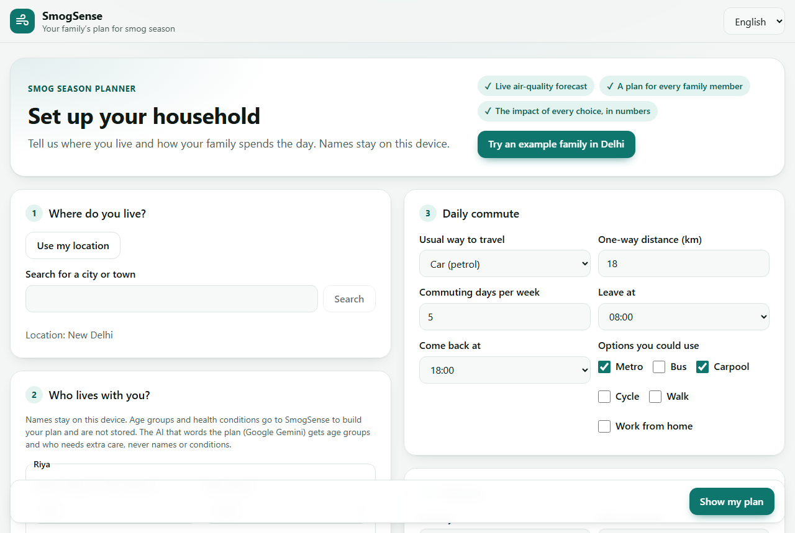
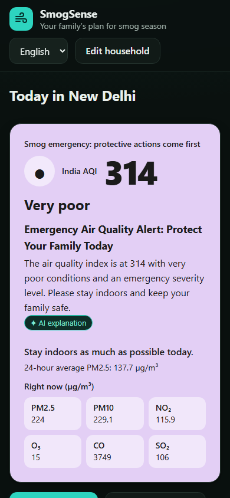

# SmogSense

[](https://github.com/kartikjoshi7/SmogSense/actions/workflows/ci.yml)
[](https://github.com/kartikjoshi7/SmogSense/actions/workflows/codeql.yml)

**Your family's plan for smog season.**

A GenAI assistant that helps families and communities get through winter smog. It reads the
live air-quality forecast for where you live, builds a plan for your household's day (low-emission
routines, indoor air hacks, sustainable alternatives) and shows the impact of every choice in
numbers. Gemini explains the plan in English or Hindi, answers questions and writes community
notices in ten languages, and it may only use the numbers the engine computed.

**Live app:** https://smog-sense-sigma.vercel.app (no sign-up; "Try an example family in Delhi"
fills the form in one click).


## Contents

- [Evidence for each judging area](#evidence-for-each-judging-area)
- [Chosen vertical](#chosen-vertical)
- [Approach and logic](#approach-and-logic)
- [How the solution works](#how-the-solution-works)
- [Features](#features)
- [Tech stack](#tech-stack)
- [Project structure](#project-structure)
- [Run it locally](#run-it-locally)
- [Deploy your own](#deploy-your-own)
- [Assumptions](#assumptions)

## Evidence for each judging area

| Area                         | In short                                                                                                                | Details                                |
| ---------------------------- | ----------------------------------------------------------------------------------------------------------------------- | -------------------------------------- |
| Code quality                 | Strict TypeScript, strict ESLint with layer rules, Prettier and knip as gates; no `any`, no type assertions             | [Code quality](docs/CODE_QUALITY.md)   |
| Security                     | Server-only key, Zod on every input, rate limits, strict CSP; every AI number checked; no names or conditions to the AI | [Security](docs/SECURITY.md)           |
| Efficiency                   | The plan never waits for the AI; cached, shared upstream calls; small prompts; lazy dialogs; no chart library           | [Efficiency](docs/EFFICIENCY.md)       |
| Testing                      | Unit, integration and Playwright end-to-end tests with axe; 100% coverage of the engine                                 | [Testing](docs/TESTING.md)             |
| Accessibility                | WCAG 2.2 AA checked by axe in light and dark, keyboard-only flow, 44 px targets, English and Hindi, read-aloud          | [Accessibility](docs/ACCESSIBILITY.md) |
| Problem statement alignment  | Each requirement of the brief traced to code and tests; real Open-Meteo data; works without the AI                      | [Alignment](docs/ALIGNMENT.md)         |
| Design decisions (all areas) | Ten records: why each choice was made, what was turned down, what it costs, and the tests that hold it                  | [Decisions](docs/DECISIONS.md)         |

How the parts fit together, request by request, is in [Architecture](docs/ARCHITECTURE.md), and
the rules every change follows are in [AGENTS.md](AGENTS.md).

## Chosen vertical

**Urban Air Quality Assistant.** The brief: _"Create a GenAI-powered assistant that helps families
and communities navigate severe winter smog and urban air pollution. The application should
suggest low-emission daily routines, indoor air quality hacks, and sustainable alternatives
tailored to their location and lifestyle, while clearly explaining the direct impact of their
choices."_

SmogSense is built for households in North Indian cities, where winter inversions trap smoke for
weeks, and it works anywhere Open-Meteo has a forecast (US AQI outside India).

### Who it is for

- **Families in North Indian cities** during winter smog, especially those with children, older
  relatives, a pregnancy or heart and lung conditions: the plan follows the most sensitive member
  and names who each action is for.
- **Communities**: housing societies, schools and workplaces, through shareable notices and
  community actions such as checking on neighbours and reporting open burning.
- **Anyone with an Open-Meteo forecast**: outside India the plan uses the US AQI.

## Approach and logic

**The engine decides and calculates; Gemini explains and talks.** A pure TypeScript decision
engine (`src/core`, no I/O, 100% test coverage) turns the forecast and the household profile into
a ranked plan with numbers. Gemini only rewrites that plan in plain language, so the numbers can be
trusted and the app keeps working when the AI is unavailable.

How `buildPlan(profile, air)` in `src/core/plan.ts` decides:

1. **Index** (`aqi.ts`): the trailing 24-hour PM2.5 and PM10 means become India's NAQI for Indian
   locations or the US AQI elsewhere, with official breakpoints.
2. **Who is most at risk** (`risk.ts`): infants, seniors and anyone with asthma, COPD, heart
   disease or a pregnancy are "high" sensitivity, children "elevated". The household is as
   sensitive as its most sensitive member, and sensitive members are told to act one band sooner.
3. **How strongly to react** (`severity.ts`): normal, caution, restrict or smog emergency. A highly
   sensitive household enters emergency mode one band early.
4. **Winter inversion** (`inversion.ts`): a low boundary layer means pollution is trapped; the
   engine says when daytime mixing should clear it, falls back to wind speed and says so, and
   says it cannot tell when there is no weather data.
5. **Candidates** (`recommendations/*`): 27 possible actions in five groups. Each is kept only if it
   fits the household (no carpool advice for someone who takes the metro) and carries its own
   numbers: exposure cut (`exposure.ts`, `windows.ts`), indoor PM2.5 before and after (`indoor.ts`,
   a mass-balance room model) and CO₂ saved per week (`emissions.ts`).
6. **Ranking** (`recommendations/rank.ts`): health benefit × how bad the air is × household
   sensitivity, plus CO₂ avoided, minus effort. In an emergency, protective actions come first.

Every requirement in the brief is traced to the code and tests that cover it in
[Problem statement alignment](docs/ALIGNMENT.md#requirement-traceability).

## How the solution works



1. **Set up (no sign-up).** Choose a place by GPS or city search, add family members (their names
   stay on the device) and describe the commute, exercise, home and winter heating. The Delhi
   example family fills the form in one click.
2. **Today.** `POST /api/plan` gets the place's air-quality and weather forecast from Open-Meteo
   and runs the engine; no AI is involved, so the plan appears at once with standard guidance.
   `POST /api/explain` then swaps in Gemini's wording item by item. The request flow, caches and
   error handling are in [Architecture](docs/ARCHITECTURE.md).
3. **The plan.** An AQI card (number with its scale, category in words, icon and colour, and every
   pollutant measured this hour), the hourly PM2.5 chart with a table view, the inversion card, the
   day's timeline, five tabs named after the brief and a "what if" slider that recomputes exercise
   exposure in the browser with the same engine.
4. **Ask and share.** A chat dialog for questions such as "Can the children play outside at 4 pm?"
   and a community notice that can be copied or shared, each in any of ten languages. Both are
   loaded only when opened.

<p>
  
  
</p>

**GenAI usage.** Gemini (through `@google/genai`) is used in three places, all in
`src/server/ai/`:

| Use              | Route                 | What the model gets and returns                                                                                                                                                                            |
| ---------------- | --------------------- | ---------------------------------------------------------------------------------------------------------------------------------------------------------------------------------------------------------- |
| Plan narrator    | `POST /api/explain`   | The highest-priority recommendations with their numbers, the household's member ids and age groups (never names or health conditions), the language → JSON headline, summary, and `why` + `steps` per item |
| Ask SmogSense    | `POST /api/chat`      | The same facts, the answer language, up to 6 earlier turns and the question inside `<user_question>` delimiters → JSON answer                                                                              |
| Community notice | `POST /api/community` | The day's facts as they apply to everyone nearby (nothing about the household), the audience and language → JSON notice                                                                                    |

Every reply must match a JSON schema and pass the numeric grounding check
([Security › AI safety](docs/SECURITY.md#ai-safety)). Anything that fails, times out or cannot be
reached is replaced by standard guidance from `src/core/explain`, and each piece of text carries
an `ai` or `fallback` label that the UI shows next to it.

**Free-tier strategy.** The app runs on a free AI Studio key: small prompts, capped tokens,
caching, a cool-down after a 429 and a daily budget ([Efficiency](docs/EFFICIENCY.md#gemini-on-the-free-tier)).

**The API.** One Hono app answers every route; each body and query is a Zod schema in
`src/shared/api.ts`, and the limits on each group of routes are in
[Security](docs/SECURITY.md#rate-limits-caches-and-budgets).

| Route                 | What it does                                               | Uses AI |
| --------------------- | ---------------------------------------------------------- | ------- |
| `GET /api/health`     | Says the API is up                                         | No      |
| `GET /api/geocode`    | Finds places by name, with names in the interface language | No      |
| `POST /api/plan`      | Builds the household's plan for a place from live data     | No      |
| `POST /api/explain`   | Words the plan's headline, summary and top items           | Yes     |
| `POST /api/chat`      | Answers a question about today's plan                      | Yes     |
| `POST /api/community` | Writes a notice for a housing society, school or workplace | Yes     |

## Features


- **A plan in five tabs named after the brief:** low-emission routines, indoor air hacks,
  sustainable alternatives, protection and community. Measurable actions show their own numbers
  (exposure cut, the room's PM2.5 before and after, CO₂ saved a week); the others show a benefit
  level. Every action and the code behind it is listed in
  [Alignment](docs/ALIGNMENT.md#requirement-traceability).
- **A timeline for the day:** when to exercise, air the home, wear a mask or run the purifier.
- **What if:** drag the exercise time and see the dose change, computed in the browser.
- **Honest AI:** every card says whether the AI or standard guidance wrote it, and the AI may
  quote only the plan's own numbers.
- **For every household:** English and Hindi, read-aloud, light and dark themes, phones and
  keyboards, no account; family names never leave the device.

## Tech stack

| Part       | Technology                                                              | Why                                                                         |
| ---------- | ----------------------------------------------------------------------- | --------------------------------------------------------------------------- |
| Language   | TypeScript (strict) for the browser, the API and the tests              | One set of types from the form to the engine                                |
| Interface  | React 19, Vite 8, Tailwind CSS 4, a hand-written SVG chart              | [Decision 10](docs/DECISIONS.md#10-no-chart-ui-kit-or-state-library)        |
| API        | Hono 4 in one Vercel function (Node 22)                                 | [Decision 3](docs/DECISIONS.md#3-one-hono-app-in-one-vercel-function)       |
| Validation | Zod 4, the same schemas on the server and in the browser                | [Decision 4](docs/DECISIONS.md#4-one-set-of-zod-schemas-on-both-sides)      |
| AI         | Google Gemini through `@google/genai`                                   | [Decisions 1 and 2](docs/DECISIONS.md#1-the-engine-decides-the-ai-explains) |
| Data       | Open-Meteo air quality, weather and geocoding (no key)                  | [Decision 9](docs/DECISIONS.md#9-open-meteo-as-the-only-data-source)        |
| Tests      | Vitest, Testing Library, jsdom, axe-core, Playwright                    | [Testing](docs/TESTING.md)                                                  |
| Quality    | ESLint 9 with typescript-eslint, Prettier, knip, GitHub Actions, CodeQL | [Code quality](docs/CODE_QUALITY.md)                                        |

## Project structure

```
api/                     the Vercel function that hands /api/* to the Hono app
src/                     the app in four layers: core, shared, server and ui
e2e/                     Playwright tests against the production build
docs/                    one doc per judging area, the architecture, the decisions and screenshots
scripts/                 check-repo.mjs: one branch, tracked files under 9 MB, no .env files
.github/workflows/       CI (check and e2e jobs) and CodeQL
AGENTS.md                the engineering rules every change follows
.pre-commit-config.yaml  optional checks before each commit, using the npm scripts
vercel.json              build, routing and security headers for Vercel
vite.config.ts           the build, the dev server's API and the preview headers
```

What each layer holds and which way imports may point is in
[Architecture › Layers](docs/ARCHITECTURE.md#layers).

## Run it locally

You need Node 22 or later. A free Gemini key from Google AI Studio is optional: without one, every
AI route answers with standard guidance.

```bash
npm ci
cp .env.example .env.local   # add GEMINI_API_KEY; without it the app uses standard guidance
npm run dev                  # UI and API on http://localhost:5173
```

| Variable                | What it sets (defaults live in `src/server/config.ts`)                  |
| ----------------------- | ----------------------------------------------------------------------- |
| `GEMINI_API_KEY`        | The Gemini key, read on the server only                                 |
| `GEMINI_MODELS`         | Model ids to try, in order, separated by commas                         |
| `GEMINI_DAILY_BUDGET`   | Gemini calls allowed per day on each server instance                    |
| `GEMINI_THINKING_LEVEL` | How much the model thinks before answering: `OFF`, `MINIMAL` or `LOW`   |
| `ALLOWED_ORIGIN`        | A full URL allowed to call the API from another site; unset allows none |

To check a change the way CI does, run `npm run check`, `npm run check:repo` and
`npm run test:e2e`. What each one enforces is in
[Code quality](docs/CODE_QUALITY.md#gates-that-fail-the-build) and [Testing](docs/TESTING.md).

## Deploy your own

1. Fork the repository and import it as a new Vercel project. `vercel.json` already holds the
   build, the routing and the headers ([Architecture › Build and
   deploy](docs/ARCHITECTURE.md#build-and-deploy)).
2. Add `GEMINI_API_KEY` to the project's environment variables (optional), and `ALLOWED_ORIGIN`
   only if another site must call the API.
3. Deploy, then open `/api/health` on your new address: it answers `{"status":"ok"}`.

## Assumptions

- **Data.** Open-Meteo's CAMS air-quality forecast and weather forecast are good enough for
  household planning. They are model estimates for a grid cell, not readings from a nearby monitor.
- **Index.** The headline index uses the trailing 24-hour mean, as CPCB and the EPA do, so it barely
  moves within a day; clean windows are found from hourly PM2.5 instead. It is computed from PM2.5
  and PM10 only: the gases are shown on the AQI card but not counted, so on a day when a gas is the
  worst pollutant the official index can read higher.
- **Privacy.** Locations are rounded before any upstream call or cache, and health conditions
  never reach the AI ([Security › Privacy](docs/SECURITY.md#privacy)).
- **Heating.** A coal or wood fire (angithi) or a kerosene heater counts as a smoke source in the
  room, at an order-of-magnitude emission rate; gas heaters, which give off little PM2.5, are not
  modelled.
- **Not modelled yet.** Commute doses use the 24-hour mean rather than the hours of travel.
- **Not medical advice.** Every figure is a planning estimate. The model is instructed not to
  diagnose and to send anyone with symptoms to a doctor, and the footer says the same.
- **Languages.** The interface and the plan's explanations are in English and Hindi. Chat answers
  and community notices can be in ten languages; their standard guidance exists in English and
  Hindi, and the other languages fall back to English.
- **Coefficients.** Every coefficient and threshold the engine uses is a named constant in
  `src/core/constants.ts`, with its source; [Architecture › Assumptions behind the
  numbers](docs/ARCHITECTURE.md#assumptions-behind-the-numbers) lists each one.

Air-quality and weather data: [Open-Meteo.com](https://open-meteo.com) (CC BY 4.0). AI:
Google Gemini. Licence: [MIT](LICENSE).
